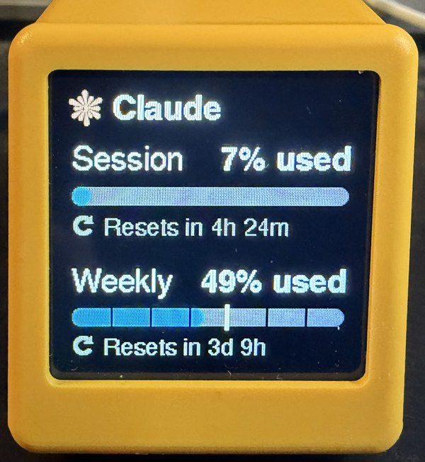
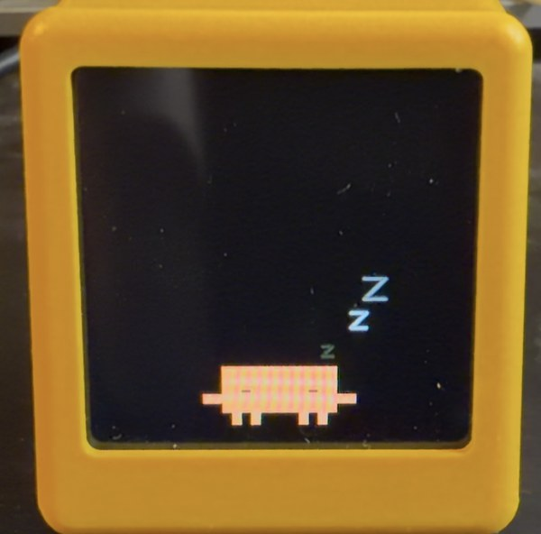

# Claude Usage Display

Turns a **GeekMagic SmallTV Ultra** (the ~£10 ESP8266 "mini TV" from AliExpress) into a desk display showing your **Claude session and weekly usage limits**, with reset countdowns.

<p align="center"></p>

- **No soldering.** You flash it over Wi-Fi through the stock firmware's update page.
- **Your Claude login never touches the display.** A small script on your laptop reads your usage and sends just the numbers to the display.
- **Locked down:** the stock firmware is replaced, wireless updates need a password, and the display only accepts data carrying your secret token.
- **Works on any Wi-Fi.** If the display can't find a known network, it opens a password-protected setup hotspot.

> ⚠️ **Unofficial.** This isn't affiliated with Anthropic or GeekMagic. It reads the same internal usage endpoint that claude.ai's own usage page uses, so it could stop working if that changes. It needs a Claude subscription (Pro or Max).

## Contents

- [How it works](#how-it-works)
- [What you need](#what-you-need)
- [Part 1: Flash the display](#part-1--flash-the-display)
- [Part 2: Turn on wireless updates](#part-2--turn-on-wireless-updates)
- [Part 3: Set up the laptop script](#part-3--set-up-the-laptop-script)
  - [Running it on a Mac](#36-running-it-on-a-mac)
- [Night mode](#night-mode)
- [Customising](#customising)
- [What the display tells you](#what-the-display-tells-you)
- [Troubleshooting](#troubleshooting)
- [Security notes](#security-notes)

---

## How it works

```
claude.ai  ──(every 3 min)──►  bridge.py on your laptop  ──(every 1 min, LAN)──►  SmallTV (smalltv.local)
```

- `bridge/` is a Python script that runs in the background on your laptop. It reads your usage with your claude.ai login cookie and pushes the numbers to the display.
- `smalltv/` is the display firmware (PlatformIO / Arduino). Between updates, it counts the reset timers down by itself.

The display only updates while your laptop is on and on the same network. After 10 minutes without an update, it shows a warning.

---

## What you need

- A **GeekMagic SmallTV Ultra**, or the plain **SmallTV**. Both use an ESP-12F / ESP8266. The **Pro** model uses an ESP32 and **won't work** with this.
- A **Windows laptop or a Mac**. Mac setup is in [step 3.6](#36-running-it-on-a-mac). Linux works too; see [Troubleshooting](#troubleshooting).
- **VS Code** with the **PlatformIO IDE** extension:
  1. Install VS Code.
  2. Open the Extensions panel (`Ctrl+Shift+X`).
  3. Search for "PlatformIO IDE" and click Install.
  4. Wait for PlatformIO to finish its first-time setup, then restart VS Code.
- **Python 3.9+** from [python.org](https://www.python.org/downloads/). Tick **"Add python.exe to PATH"** during install.
- A **Claude Pro or Max** subscription.

Download this repo with **Code → Download ZIP** on GitHub, then unzip it somewhere sensible, such as `Documents`.

---

## Part 1 – Flash the display

> ⚠️ **Read this first.** Once you upload this firmware, the original GeekMagic firmware is gone, and going back to it isn't reliable. Make sure your passwords are set correctly before step 1.4.

### 1.1 Set your passwords

1. In `smalltv/src/`, copy `secrets.example.h` and rename the copy to **`secrets.h`**.
2. Open `secrets.h` and replace all three values with your own long random strings.
   - A quick way to get one: open PowerShell, run `[guid]::NewGuid()`, and copy the result. Run it once for each value.
   - Use a **different value for each**.
   - Each value must be **at least 8 characters**.

| Setting | What it's for |
|---|---|
| `SETUP_AP_PASS` | Password for the `SmallTV-Setup` hotspot you use to give the display your Wi-Fi details |
| `OTA_PASS` | Password for sending new firmware to the display over Wi-Fi |
| `PUSH_TOKEN` | Shared secret between the laptop script and the display. You'll paste it again in Part 3 |

Keep a note of all three. `secrets.h` is git-ignored, so it never gets uploaded anywhere.

### 1.2 Build the firmware

1. In VS Code, use **File → Open Folder** and select the **`smalltv`** folder itself, not the repo root. PlatformIO only recognises the project when `platformio.ini` is at the top level.
2. Wait for PlatformIO to finish downloading its tools. This is slow the first time.
3. Click **Build** (the ✓ in the bottom status bar), or press `Ctrl+Alt+B`.
   - **Don't click Upload yet.**
   - If there's no ✓, open the alien-head icon in the left sidebar and go to **Project Tasks → smalltv → General → Build**.
4. It should finish with `SUCCESS`. The firmware file is at `smalltv/.pio/build/smalltv/firmware.bin`.

### 1.3 Connect to the display's stock web page

1. Power the display with USB-C. The stock firmware shows instructions on screen.
2. If it's not already on your Wi-Fi, connect your phone or laptop to its setup hotspot as the screen tells you, and give it your Wi-Fi details.
3. Note the **IP address** shown on the display's screen.
4. On a device on the same Wi-Fi, open that IP address in a browser.

### 1.4 Upload the firmware

1. On the stock web page, find **Firmware update** (sometimes under Settings or Update).
2. Choose `firmware.bin` from step 1.2 and upload it.
3. **Don't unplug it** until it reboots.

### 1.5 Give it your Wi-Fi details

After rebooting, the display shows one of these:

- **Yellow "Wi-Fi setup":**
  1. On your phone, join the Wi-Fi network **`SmallTV-Setup`** using your `SETUP_AP_PASS`.
  2. A setup page should pop up. If it doesn't, go to `192.168.4.1` in a browser.
  3. Pick your Wi-Fi network and enter its password.
- **The Claude layout with "Waiting for laptop" at the bottom:** it's on your Wi-Fi. Move on to Part 2.

The display remembers networks. If you take it somewhere new, it opens the setup hotspot again automatically.

---

## Part 2 – Turn on wireless updates

From now on you update the display from VS Code over Wi-Fi, with no web page needed.

1. In the `smalltv` folder, copy `ota.example.ini` and rename the copy to **`ota.ini`**. Like `secrets.h`, it's git-ignored, so your password never gets committed.
2. In `ota.ini`, replace `YOUR_OTA_PASS` with your `OTA_PASS`.
3. Check it looks exactly like this. The two indented lines are meant to be indented, and the others must start at the left edge:
   ```ini
   [env:smalltv]
   upload_protocol = espota
   upload_port = smalltv.local
   upload_flags =
     --auth=your-ota-password
     --host_port=8270
   ```
4. Let the display connect back to your laptop through Windows Firewall:
   1. Right-click Start and choose **Terminal (Admin)**.
   2. Run:
      ```powershell
      New-NetFirewallRule -DisplayName "PlatformIO OTA" -Direction Inbound -Protocol TCP -LocalPort 8270 -Action Allow -Profile Private
      ```
   3. Make sure your Wi-Fi is set to **Private**: go to **Settings → Network & internet → Wi-Fi →** your network → **Network profile type: Private**.
5. Click **Upload** (→ in the status bar). The display shows "Updating…" and then restarts.

> 💡 **VS Code gotcha:** PlatformIO saves every open file before it uploads. If you've edited a file outside VS Code, or replaced it with a newer version, while VS Code still has the old one open, VS Code will save the old one back over it. Close the tab first, or use `Ctrl+Shift+P` → **Revert File**.

---

## Part 3 – Set up the laptop script

### 3.1 Install

Double-click **`bridge/setup.bat`**. It:
- creates a private Python environment in `bridge/.venv`
- installs the one dependency, `curl_cffi`
- creates `bridge/config.json` from the example

### 3.2 Get your claude.ai session key

1. Log in to [claude.ai](https://claude.ai) in Chrome or Edge.
2. Open the developer tools. Any of these works:
   - `F12`
   - `Fn+F12` on most laptops
   - `Ctrl+Shift+I`
   - **⋮ → More tools → Developer tools**
3. Click the **Application** tab. If you can't see it, it may be hidden behind **»**.
4. In the left sidebar, open **Cookies → https://claude.ai**.
5. Click **`sessionKey`** and copy its full value. It starts `sk-ant-sid…` and is long.

> 🔒 **This key is as good as your password.** Anyone who has it can use your Claude account. Only ever put it in `config.json` on your own laptop, which is git-ignored. Never paste it anywhere else.

### 3.3 Fill in `bridge/config.json`

Open it in Notepad or VS Code:

```json
{
  "session_key": "sk-ant-sid...your key...",
  "push_token": "the same PUSH_TOKEN you put in secrets.h",
  "display": "smalltv.local",
  "poll_seconds": 180
}
```

Keep the quotes and commas exactly as shown, then **save** the file.

### 3.4 Test

Double-click **`bridge/test.bat`**.
- It prints your usage and should end with **`Display answered HTTP 200`**.
- The display should now show your real numbers.
- If it fails, see [Troubleshooting](#troubleshooting).

### 3.5 Start it automatically with Windows

1. Right-click `bridge/run_bridge.bat` → **Show more options → Create shortcut**.
2. Press `Win+R`, type `shell:startup`, and press Enter.
3. Move the shortcut into the folder that opens.
4. Double-click the shortcut once to start it now.

It then runs silently in the background whenever you're logged in.
- To stop it, run `bridge/stop_bridge.bat`.
- For a log of what it's doing, see `bridge/bridge.log`.

Resource use: it checks claude.ai once every 3 minutes and sleeps the rest of the time, so the battery and CPU impact is negligible.

### 3.6 Running it on a Mac

The `.bat` files are Windows-only. On a Mac, do steps 3.1–3.5 like this instead.

**Install and test** (in Terminal):
```bash
cd path/to/Claude-Usage-Monitor/bridge
python3 -m venv .venv && .venv/bin/pip install -r requirements.txt
cp config.example.json config.json    # then fill it in as in step 3.3
.venv/bin/python bridge.py --test     # should end with "Display answered HTTP 200"
```
To open the developer tools in step 3.2, press `Cmd+Option+I`.

**Start it automatically when you log in.** macOS runs background programs from a *launch agent*. Create `~/Library/LaunchAgents/com.claude-usage-bridge.plist` with the following, replacing both `/FULL/PATH/TO/bridge` with your real path (e.g. `/Users/you/Documents/Claude-Usage-Monitor/bridge`):
```xml
<?xml version="1.0" encoding="UTF-8"?>
<!DOCTYPE plist PUBLIC "-//Apple//DTD PLIST 1.0//EN" "http://www.apple.com/DTDs/PropertyList-1.0.dtd">
<plist version="1.0">
<dict>
  <key>Label</key><string>com.claude-usage-bridge</string>
  <key>ProgramArguments</key>
  <array>
    <string>/FULL/PATH/TO/bridge/.venv/bin/python</string>
    <string>/FULL/PATH/TO/bridge/bridge.py</string>
  </array>
  <key>WorkingDirectory</key><string>/FULL/PATH/TO/bridge</string>
  <key>RunAtLoad</key><true/>
  <key>KeepAlive</key><true/>
  <key>ThrottleInterval</key><integer>60</integer>
  <key>StandardOutPath</key><string>/dev/null</string>
  <key>StandardErrorPath</key><string>/FULL/PATH/TO/bridge/bridge.err.log</string>
</dict>
</plist>
```
Then start it:
```bash
launchctl bootstrap gui/$(id -u) ~/Library/LaunchAgents/com.claude-usage-bridge.plist
```

**Where it runs and how to control it**

| | |
|---|---|
| What runs | `bridge/bridge.py`, using the Python in `bridge/.venv`. No window; it runs in the background |
| What starts it | The launch agent above. macOS starts it at every login and restarts it if it crashes |
| Activity log | `bridge/bridge.log`: fetches, errors, and `Display updated OK` |
| Crash log | `bridge/bridge.err.log`: empty unless the script crashed |
| Is it running? | `launchctl print gui/$(id -u)/com.claude-usage-bridge \| grep state` |
| Stop it | `launchctl bootout gui/$(id -u) ~/Library/LaunchAgents/com.claude-usage-bridge.plist` |
| Start it | `launchctl bootstrap gui/$(id -u) ~/Library/LaunchAgents/com.claude-usage-bridge.plist` |
| After editing `config.json` | Stop it, then start it |
| Remove it for good | Stop it, then delete the `.plist` file |

> 💡 **macOS Local Network privacy.** macOS silently blocks background Python from reaching devices on your network (`No route to host` in the log), and never offers a permission prompt for it. So on a Mac the script sends to the display through Apple's built-in `/usr/bin/curl`, which is allowed. You don't need to change any settings.

The display only updates while the Mac is awake and on the same Wi-Fi. When it sleeps, the display shows `No update for Xm` after 10 minutes and recovers on its own when the Mac wakes.

---

## Night mode

<p align="center"></p>

Between **midnight and 7am** the display dims and goes black, except for a small mascot at the bottom snoring, with Zs drifting up from its head. At 7am the normal screen comes back.

- **Clock:** the display gets the time from the internet (NTP), so night mode works even when your computer is off or asleep. It's set to UK time; change `TZ_INFO` for another timezone (see [Customising](#customising)).
- **Still at your Mac? It stays on.** On a Mac, the script tells the display with every update whether your screen is unlocked. At night, the display stays on while your Mac is unlocked. Lock it, or let it sleep, and the display sleeps within about 3 minutes. Nothing needs setting up for this.
- On Windows and Linux the script doesn't report lock state, so the display always sleeps during the night window.
- **Preview the sleep screen** at any time. This shows it for 2 minutes (put in your `PUSH_TOKEN`):
  ```bash
  curl -X POST -H "X-Token: YOUR_PUSH_TOKEN" -d "demo=120" http://smalltv.local/u
  ```

---

## Customising

All of these are near the top of `smalltv/src/main.cpp`. Click **Upload** after changing any of them.

| What | Where |
|---|---|
| Brightness | `#define BRIGHTNESS 40`, as a percentage from 1 to 100 |
| Colours | the `C_...` lines, e.g. `C_BG` for the background and `C_BLUE` for the bar |
| Amber/red thresholds | `barColour()`: amber at 75%, red at 90% |
| "Stale" warning delay | `STALE_MS`, 10 minutes by default |
| Night mode hours | `NIGHT_START_H` and `NIGHT_END_H`, 0 and 7 by default. The window can cross midnight, e.g. 22 and 7 |
| Night brightness | `NIGHT_BRIGHTNESS`, as a percentage, 12 by default |
| Timezone | `TZ_INFO`, a POSIX TZ string. UK by default (`GMT0BST,M3.5.0/1,M10.5.0`); e.g. US Eastern is `EST5EDT,M3.2.0,M11.1.0` |
| How long "Mac unlocked" keeps it on | `AWAKE_MS`, 3 minutes after the last update that said unlocked |

To change how often the script checks claude.ai, edit `poll_seconds` in `config.json`.
- The minimum is 120, because faster polling risks being rate-limited.
- Restart the script after changing it.

---

## What the display tells you

| Display | Meaning |
|---|---|
| `Resetting...` | The window's reset time has passed. It updates at the next check, within 3 minutes |
| Bar turns amber or red | Over 75% or over 90% used |
| Weekly bar split into 7 segments | One segment per day of your weekly window. Days count from when the window started, not from midnight |
| White marker on the weekly bar | Today's target: the end of the current day, ~14% per day. Stay left of it and your usage lasts the whole week |
| Black screen with a snoring mascot | Night mode, from midnight to 7am. See [Night mode](#night-mode) |
| Screen layout shifts up | A message has appeared at the bottom. When everything's fine, the layout spreads out to fill the whole screen |
| `Waiting for laptop  <IP>` | No data received yet since the display booted |
| `No update for Xm - laptop off?` | The laptop script hasn't sent anything for over 10 minutes |
| `sessionKey expired - update it` | Copy a fresh `sessionKey` into `config.json` (step 3.2), then restart the script |
| `Blocked by claude.ai - retrying` | claude.ai's bot protection blocked a request. It usually clears on its own |
| `Laptop can't reach claude.ai` | The laptop has no internet connection |

---

## Troubleshooting

**No ✓ / Build button in VS Code.**
You've opened the wrong folder. Open the `smalltv` folder itself (step 1.2).

**`unrecognized command-line option '--auth=...'` when uploading.**
The upload lines in `ota.ini` are indented when they shouldn't be. `upload_protocol`, `upload_port` and `upload_flags =` must start at the very left edge (Part 2, step 3).

**Upload says `Authenticating...OK` then `No response from device`.**
Windows Firewall is blocking the display from connecting back to your laptop. Add the firewall rule and set your network to Private (Part 2, step 4).

**Upload can't find `smalltv.local`.**
Replace `smalltv.local` with the IP address shown on the display, in `ota.ini` and/or `config.json`.

**`test.bat` says `FAILED (auth)`.**
Your `sessionKey` is wrong or expired. Copy it again, including the whole value.

**`test.bat` says push failed / 403.**
`push_token` in `config.json` doesn't exactly match `PUSH_TOKEN` in `secrets.h`. Make them match, then Upload the firmware again if you changed `secrets.h`.

**Colours look wrong.**
In `platformio.ini`:
- Red and blue swapped: change `TFT_BGR` to `TFT_RGB`.
- Colours look like a negative: delete the `TFT_INVERSION_ON` line.

**More than one display on the same network.**
Each needs a different name:
1. Change `"smalltv"` in `ArduinoOTA.setHostname("smalltv")` in `main.cpp`.
2. Use the new name in `upload_port` (`ota.ini`) and `display` (`config.json`).

**Upload failed, and now the display is stuck or blank.**
- If the screen shows anything, wireless updates still work. Fix the code and Upload again.
- If it's completely dead:
  1. Open the case (two screws on the bottom).
  2. Connect a 3.3 V USB-serial adapter to the TX, RX, 3V3 and GND pads.
  3. Hold GPIO0 to GND while plugging it in, then flash with `upload_protocol = esptool`.

**Mac.** See [step 3.6](#36-running-it-on-a-mac).

**Linux.**
The `.bat` files are Windows-only, but the script itself works anywhere:
```bash
cd bridge
python3 -m venv .venv && .venv/bin/pip install -r requirements.txt
cp config.example.json config.json   # then edit it
.venv/bin/python bridge.py --test    # test
.venv/bin/python bridge.py           # run (use a systemd user service or cron @reboot to auto-start)
```

---

## Security notes

- **Credentials:** your claude.ai `sessionKey` stays on your laptop. The display only ever receives percentages and countdowns.
- **Display protection:**
  - The stock firmware, with its open web UI, is replaced.
  - The display accepts new data only with the correct `PUSH_TOKEN`.
  - Wireless updates need `OTA_PASS`.
  - The setup hotspot is WPA2-protected and only appears when no known Wi-Fi is available.
- **Limits of that protection:** traffic between the laptop and the display is plain HTTP on your local network, and the ESP8266's OTA authentication is basic. That's fine at home, but for extra isolation put the display on a guest or IoT network.
- **Never commit `secrets.h`, `ota.ini` or `config.json`.** The `.gitignore` already excludes all three.

## Credits

- Display pinout from the [ESPHome devices page for the GeekMagic Ultra](https://devices.esphome.io/devices/geekmagic-ultra/) and the Home Assistant community thread.
- Built with [TFT_eSPI](https://github.com/Bodmer/TFT_eSPI) and [WiFiManager](https://github.com/tzapu/WiFiManager).

## License

MIT. See [LICENSE](LICENSE).
